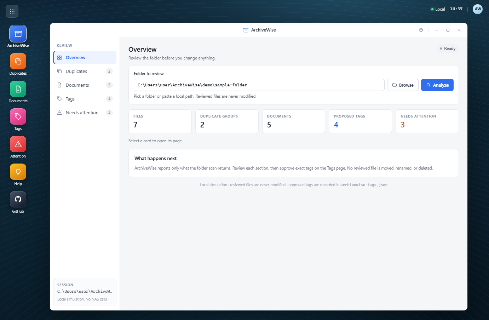

# ArchiveWise

**An evidence-based folder review Skill for UGREEN AI NAS — review duplicates, understand documents, and tag approved files.**

ArchiveWise is a Uliya Skill for the UGREEN NAS Skill Hackathon 2026 (Track: **Automate Your Workflow**). It reviews one user-selected NAS folder, reports the duplicate groups returned by the NAS duplicate scan, extracts requested document facts with source evidence, and proposes tags. Nothing is tagged until the user approves the exact files and tag names.



## What it does

- **Scope first.** Accepts one folder path or relative folder name; never scans the whole NAS.
- **Duplicates as evidence.** Reports only groups returned by the NAS duplicate scan; never infers duplicates from names or sizes.
- **Document findings with sources.** Extracts requested fields such as type, date, project, and status, with a source path and evidence excerpt.
- **Explicit approval.** Presents exact file and tag pairs and waits for approval, including approval to create a new tag.
- **Honest states.** Reports `completed`, `failed`, `cancelled`, `waiting_user`, and `waiting_approval` without describing planned work as done.
- **Preserves files.** This version does not delete, move, rename, compress, or share any reviewed file.

## Submission artifacts

| Artifact | File |
|---|---|
| Pre-test Skill package | [`dist/archivewise.zip`](dist/archivewise.zip) |
| Round 1 proposal (PDF) | [`dist/ArchiveWise-Round1-Proposal.pdf`](dist/ArchiveWise-Round1-Proposal.pdf) |
| Validation record | [`docs/validation-record.md`](docs/validation-record.md) |
| Disclosures | [`archivewise/references/disclosures.md`](archivewise/references/disclosures.md) |

## Validation status

| Check | Result |
|---|---|
| Bundled Uliya checker | **`static-pass`** — 0 errors, 0 warnings, 0 info |
| Package | 3 files, 15,609 bytes uncompressed, 6,622-byte ZIP |
| Proposal | 445 words for the ten prompts, 2 pages |
| Runtime | No NAS runtime claim; real behavior requires finalist NAS testing |

A static pass proves package structure and catalog mapping only. It does not prove upload, installation, permissions, compatibility, or behavior on a NAS device.

## Repository layout

| Path | Contents |
|---|---|
| `archivewise/` | The submitted Skill: `SKILL.md` and linked Markdown references |
| `dist/` | Submission ZIP and proposal PDF |
| `docs/` | Proposal source, test cases, capability verification, walkthrough, validation record |
| `demo/` | Local simulator and web GUI — **not part of the submitted ZIP** |
| `build.md` | Round 1 project plan and acceptance criteria |

The third-party `uliya-skill-kit-0.7.3-en/` directory is used locally for checking and is intentionally not committed.

## Try the local demo

The Skill itself runs inside UGREEN's NAS expert runtime. This repository includes a clearly labeled local simulator so you can try the review and approval experience without a NAS:

```powershell
python demo\gui_server.py
```

It opens <http://127.0.0.1:8765/>. Use the page navigation to inspect duplicates, documents, tags, and unresolved items. On the Tags page, tick the tags you approve and press **Approve selected**. Reviewed files are never modified; approved tags are recorded in `archivewise-tags.json` inside the reviewed folder.

See [`demo/README.md`](demo/README.md) for GUI details, the CLI mode, and the demo's honest limits.

## Try the real Skill

Upload `dist/archivewise.zip` to UGREEN SkillHub or submit it through the hackathon, then run the trigger on a NAS:

> Review my `Downloads/2026-Projects` folder for duplicates and documents I should keep or tag.

## Documentation

- [Round 1 plan](build.md)
- [Proposal source](docs/proposal.md)
- [Test cases](docs/round1-test-cases.md)
- [Capability verification](docs/capability-verification.md)
- [Planned walkthrough](docs/walkthrough-2026-11-12.md)
- [Submission checklist](docs/round1-submission-checklist.md)

## Disclosure

Built with the UGREEN Uliya Skill Creation Tool (kit 0.7.3), OpenCode, and OpenAI Codex. No third-party code or libraries are bundled in the Skill package. See [`archivewise/references/disclosures.md`](archivewise/references/disclosures.md) for tools, sources, licenses, and the runtime data-flow boundary.
