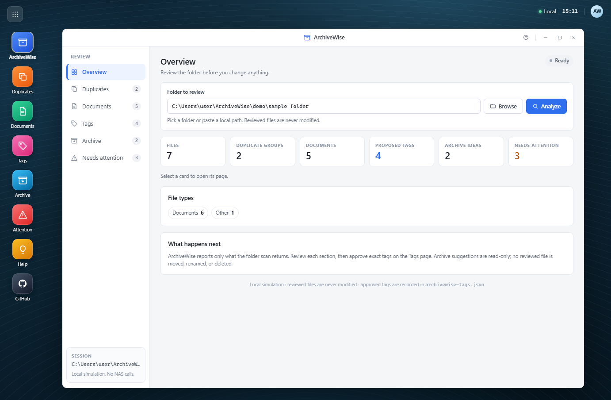
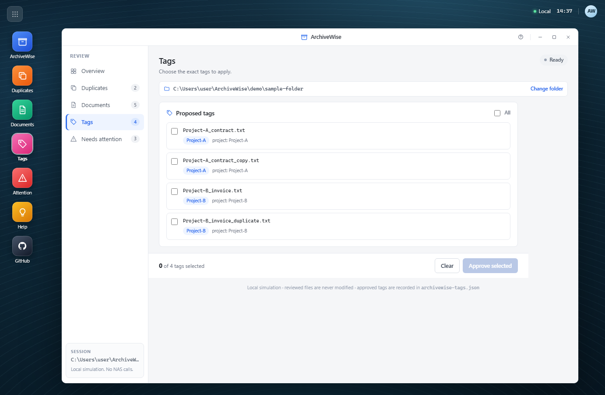
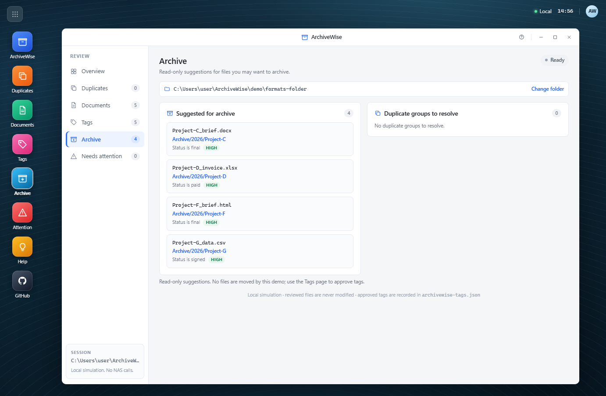
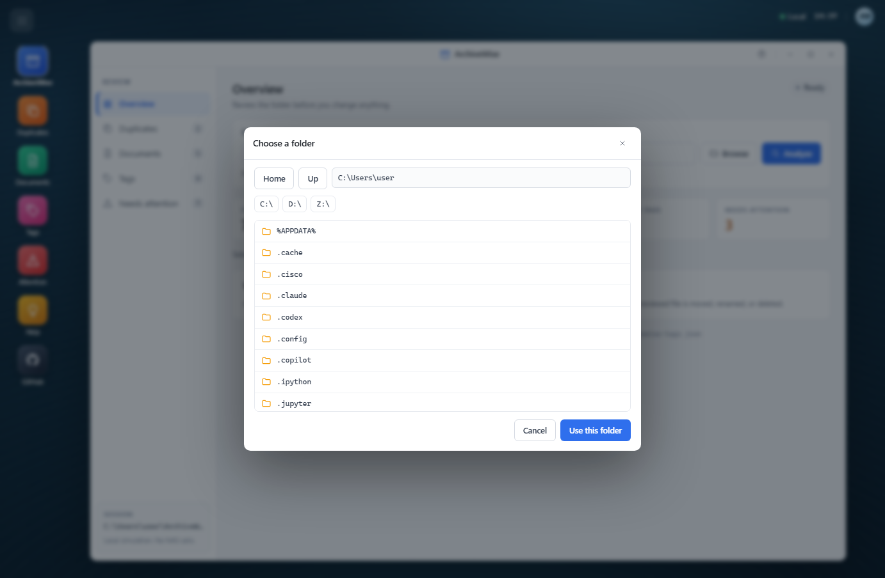
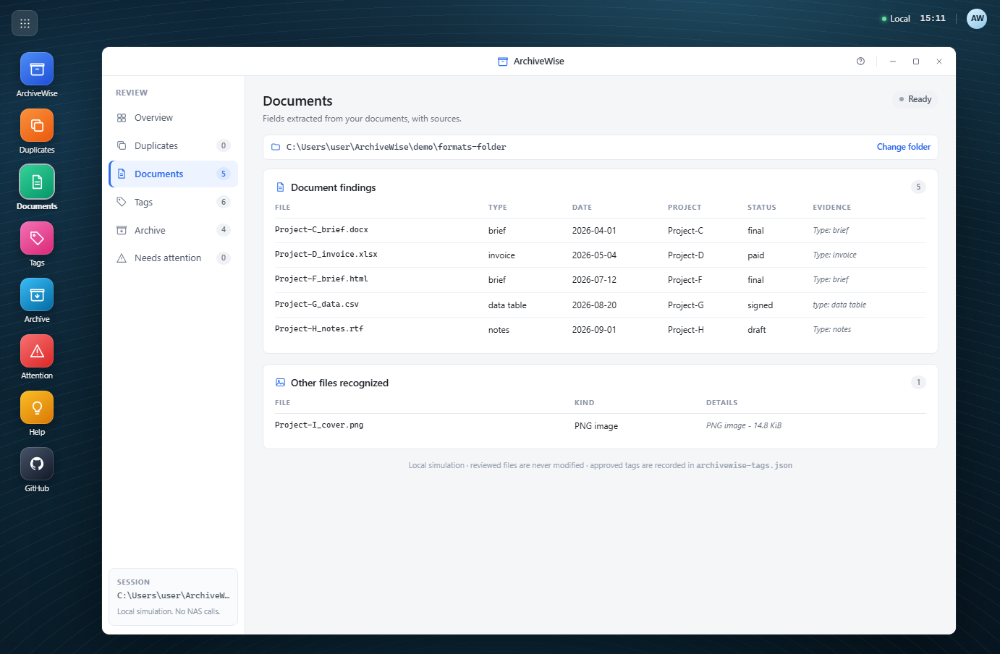

# Try ArchiveWise locally

The submitted Skill (`archivewise/`) is a Uliya orchestration package. Its real runtime is the UGREEN NAS expert environment, which provides `file-agent`, `document-agent`, and the `delegate` interface.

This folder is a **local simulator** of the review and approval experience. It calls no NAS capability, and it is not part of the submitted ZIP. It exists so you can try the flow on this PC before NAS access is available. The preview is styled after the UGREEN UGOS desktop.



## Pages

Every item under **Review** has its own page, and the dock, sidebar, and mobile chips all switch between them:

| Page | Contents |
|---|---|
| **Overview** | Folder picker, review summary, and links into each section |
| **Duplicates** | Only the duplicate groups returned by the scan |
| **Documents** | Extracted document fields, plus other recognized file types |
| **Tags** | Project tags and file-type tags for recognized images/media |
| **Archive** | Read-only archive destinations and duplicate groups to resolve |
| **Needs attention** | Unknown or legacy file types, unreadable files, and files without a tag proposal |

The selected folder remains visible on every page, with a **Change folder** link back to Overview.

## Launch the GUI

```powershell
python demo\gui_server.py
```

The browser opens at <http://127.0.0.1:8765/>.

1. The sample folder loads automatically.
2. Paste a local folder path and press **Analyze**, or press **Browse** to open the in-app folder browser.
3. Open each Review page to inspect duplicates, documents, tags, archive ideas, and unresolved items.
4. On the **Tags** page, tick the tags you approve and press **Approve selected**.
5. Approved tags are recorded in `archivewise-tags.json` inside the reviewed folder.







Options:

```powershell
# Do not open a browser automatically
python demo\gui_server.py --no-browser

# Start on a different port (tries 20 ports from there)
python demo\gui_server.py --port 9000
```

The server binds to `127.0.0.1` only. Press `Ctrl+C` to stop it.

## Command line (optional)

```powershell
# Interactive review of the sample folder
python demo\archivewise_demo.py

# Review only, no changes
python demo\archivewise_demo.py --no-input

# Approve every proposal automatically
python demo\archivewise_demo.py --approve-all

# Review your own folder
python demo\archivewise_demo.py "C:\Users\user\Documents\some-folder"
```

## What it does

1. Resolves the folder and lists files (depth 3, up to 200 files).
2. Groups byte-identical files by SHA-256.
3. Classifies the top 20 common file extensions.
4. Reads supported documents and extracts `Type`, `Date`, `Project`, and `Status`.
5. Presents duplicate groups, document findings, other file types, proposed tags, archive suggestions, and unresolved items.
6. Asks for approval of exact file and tag pairs.
7. Records approved tags in `archivewise-tags.json` inside the reviewed folder.

Archive suggestions are read-only. No file is moved by this demo.

## File type recognition

The demo recognizes these 20 extensions:

```text
.pdf .docx .doc .xlsx .xls .pptx .ppt .txt .csv .md
.json .xml .html .rtf .jpg .jpeg .png .gif .mp4 .mp3
```

| Kind | Behavior |
|---|---|
| Documents | Extract fields, propose project tags, and suggest archive destinations |
| Images (`.jpg`, `.jpeg`, `.png`, `.gif`) | Listed under **Documents > Other files recognized** and proposed as an `image` type tag |
| Video (`.mp4`) | Listed as other files and proposed as a `video` type tag |
| Audio (`.mp3`) | Listed as other files and proposed as an `audio` type tag |
| Legacy Office (`.doc`, `.xls`, `.ppt`) | Recognized, but sent to **Needs attention** with a conversion hint |
| Unknown extensions | Sent to **Needs attention** as unknown file types |

Images, video, and audio are identified by extension and file size; no OCR, duration, or media decoding is performed.

## Supported document formats

| Format | Extensions | Notes |
|---|---|---|
| Plain text / Markdown | `.txt`, `.md`, `.markdown`, `.log` | Standard library |
| Web / data | `.html`, `.htm`, `.json`, `.xml`, `.csv` | Standard library |
| Word | `.docx` | OOXML text extraction |
| Excel | `.xlsx` | OOXML cell text extraction |
| PowerPoint | `.pptx` | OOXML slide text extraction |
| RTF | `.rtf` | Basic text extraction |
| PDF | `.pdf` | Optional: `pip install -r demo/requirements.txt` |

Install optional PDF support:

```powershell
python -m pip install -r demo\requirements.txt
```

If `pypdf` is not installed, PDFs appear under **Needs attention** with a clear message instead of being guessed.

## Try the formats sample

The main sample folder stays text-only. To see the other formats, open this folder in the GUI:

```text
demo/formats-folder
```

It contains Word, Excel, HTML, CSV, and RTF documents plus a PNG image. Expected result: **6 files, 5 documents, 6 proposed tags, 4 archive suggestions, 1 other file**.



## What the sample folder shows

| File | Purpose |
|---|---|
| `Project-A_contract.txt` + `Project-A_contract_copy.txt` | One duplicate group; both propose the `Project-A` tag |
| `Project-B_invoice.txt` + `Project-B_invoice_duplicate.txt` | One duplicate group; both propose the `Project-B` tag |
| `notes.txt` | Missing project field, so no tag is proposed |
| `broken.txt` | Invalid UTF-8, reported as unresolved |
| `scan.bin` | Unknown file type, reported under Needs attention |

## Honest limits

- This is a **simulation**, not the Uliya Skill runtime.
- Duplicate detection uses local SHA-256, not UGREEN `scan-dedupe`.
- Word, Excel, PowerPoint, HTML, CSV, RTF, JSON, XML, and Markdown use the standard library. PDF requires the optional `pypdf` package.
- Office extraction is text-only; formatting, images, and embedded objects are not extracted.
- Images, video, and audio are identified by extension and file size only. The demo does not perform OCR, read dimensions, or parse media duration.
- Legacy `.doc`, `.xls`, and `.ppt` files are recognized but not extracted; save them as the modern Office format to extract fields.
- Type tags are generic (`image`, `video`, `audio`) and are not derived from file content.
- Archive suggestions are read-only. The demo never moves, deletes, renames, or rewrites a reviewed file.
- Tags are written to a JSON sidecar, not applied as NAS tags.
- There are no platform approval gates or registered NAS experts in this demo.
- The submitted package remains `dist/archivewise.zip`, built only from `archivewise/SKILL.md` and its linked references.

## Try the real Skill

Upload `dist/archivewise.zip` to UGREEN SkillHub or submit it through the hackathon, then run the trigger on a NAS:

> Review my `Downloads/2026-Projects` folder for duplicates and documents I should keep or tag.
